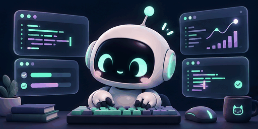
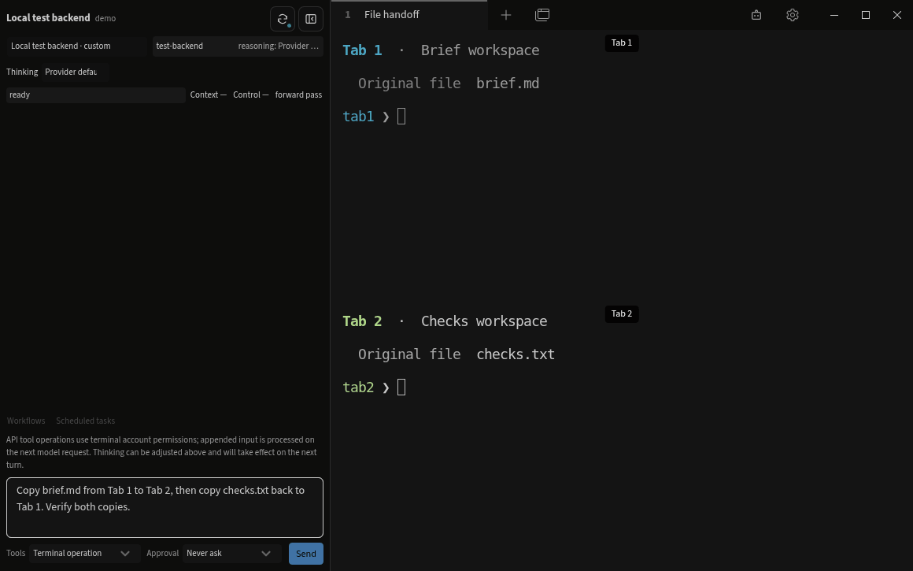

<h1>Tabby AI Tools</h1>

One AI sidebar for the terminals you already have open.

[Quick start](#quick-start) · [Model connections](#model-connections) · [User guide](docs/guide.md) · [Release notes](https://github.com/Hanlen/tabby-ai-tools/releases) · [简体中文](README.zh-CN.md)

<picture>
  <source media="(prefers-reduced-motion: reduce)" srcset="https://raw.githubusercontent.com/Hanlen/tabby-ai-tools/main/docs/assets/robot-multitask.png">
  
</picture>

## Two terminals, one task

<picture>
  <source media="(prefers-reduced-motion: reduce)" srcset="https://raw.githubusercontent.com/Hanlen/tabby-ai-tools/main/docs/assets/two-terminal-demo.png">
  
</picture>

*Recorded in Tabby with a local test backend. Both panes execute real commands on sample files.*

- Read output and run commands across local and SSH terminal tabs from one conversation.
- Use your existing SSH connections to transfer files. Save recurring work as workflows or schedule it while Tabby is open.
- Connect external AI clients to Tabby’s terminal tools through [MCP](docs/mcp.md).

## Quick start

1. In [Tabby](https://github.com/Eugeny/tabby), open **Settings → Plugins**, install `tabby-ai-tools`, and restart Tabby.
2. Open **AI Tools** from the robot icon. Choose a connection or add one under **Settings → AI Tools → Connections and models**.
3. Open the terminals you want to use. Describe the task in the sidebar and send with **Ctrl+Enter** or **Cmd+Enter**.

## Model connections

| Connection | Setup |
| --- | --- |
| **ChatGPT via Codex CLI** | Install Codex CLI, run `codex login` with a ChatGPT account that has Codex access, and select **Codex (local login)**. This mode uses your ChatGPT entitlement. [Codex sign-in](https://learn.chatgpt.com/docs/auth#codex-cli) |
| **Claude Code local login** | Install Claude Code. For a private session space, generate its login command in AI Tools, run it in a local terminal, then check and reconnect. [Claude Code setup](docs/claude-code.md) |
| **OpenAI, DeepSeek, GLM, or Claude API** | Add the provider in AI Tools and enter its API key and model ID. |
| **Kimi, Alibaba Cloud Coding Plan, or a custom endpoint** | Choose a provider preset or configure an endpoint and model. [Coding plans](docs/coding-plans.md) · [Pi and custom connections](docs/pi.md) |

[Workflows](docs/task-workflows.md) · [Scheduled tasks](docs/scheduled-tasks.md) · [Development](docs/development.md)
