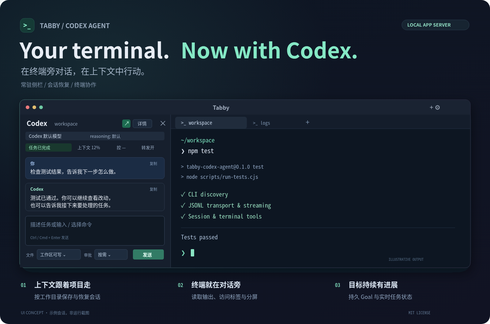

<div align="center">

# Tabby Codex Agent

**把 Codex 放进终端，让上下文留在工作现场。**

在 Tabby 左侧与 Codex 对话，读取终端输出、操作标签，并接着上次的任务继续工作。

[](https://github.com/Hanlen/tabby-codex-agent/actions/workflows/check.yml)
[](package.json)
[](https://github.com/Eugeny/tabby)
[](LICENSE)

[快速开始](#快速开始) · [功能亮点](#功能亮点) · [使用指南](docs/guide.md) · [开发与验证](docs/development.md)



<sub>根据现有面板功能绘制的界面示意，内容为示例；实际外观随 Tabby 主题和窗口尺寸变化。</sub>

</div>

## 为什么放在 Tabby 里？

排查报错时，直接让 Codex 读取终端；切换项目时，回到该目录的会话；需要执行操作时，在同一个窗口里查看输出、回答问题和处理审批。

插件通过本机的 `codex app-server` 工作。每个 Tabby 窗口复用一个后台进程，收起侧栏后仍保留面板与会话，连接异常时自动重连。

## 快速开始

### 1. 准备环境

- 安装 [Tabby](https://github.com/Eugeny/tabby) 和 Node.js 20+（用于构建插件）。
- 安装 Codex CLI，并在终端执行 `codex login` 完成登录。
- 使用支持 `thread/goal/*` 的 CLI 版本；项目已有 `codex-cli 0.162.1` 的[验证记录](VALIDATION.md)。

### 2. 构建并安装

```bash
git clone https://github.com/Hanlen/tabby-codex-agent.git
cd tabby-codex-agent
npm ci
npm run build
```

在 Tabby 打开 **Settings → Plugins → Open Plugins Directory**，复制打开的目录路径，再执行：

```bash
npm run install:tabby -- "<Tabby 插件目录路径>"
```

将尖括号及其中的文字替换为实际路径，然后**完全退出并重启 Tabby**。安装后在插件设置的「已安装插件」中查看。

### 3. 开始第一个任务

1. 打开本地终端并进入项目目录。
2. 点击 Tabby 工具栏的机器人图标，打开左侧 Codex 面板。
3. 输入任务，按 **Ctrl+Enter / Cmd+Enter** 发送。

```text
看看当前终端的报错，帮我定位原因并验证修复结果。
```

默认自动查找 `codex`，使用当前本地终端目录和 Codex 默认模型。需要指定 CLI 路径、固定目录或权限时，打开 **Settings → Codex AI**。

> 默认权限为「工作目录可写」与「按需询问」。模型、推理强度和权限也可以在侧栏中调整，下一回合生效。

## 功能亮点

| 能力 | 实际使用体验 |
| :--- | :--- |
| **常驻侧栏** | 对话与终端并排显示，拖动边缘调整宽度，收起再打开继续使用。 |
| **按目录恢复会话** | 每个工作目录保存线程，重启后恢复上下文；`/resume` 可找回该目录的历史会话。 |
| **访问标签与分屏** | Codex 可列出标签、读取终端屏幕与滚屏、切换标签、向运行中的终端发送输入，也可读取普通标签的文本与控件。 |
| **终端输出自动转发** | 从目标终端打开侧栏即可绑定，只转发新增输出；可在「详情」中停止。 |
| **持续任务目标** | 每条新任务设置持久 Goal，跟踪完成状态；目标仍在进行时可以继续执行。 |
| **流式交互** | 实时显示回复、工具输出、提问选项与审批请求；执行中可追加指令。 |
| **模型与用量可见** | 切换模型及推理强度，在「详情」中查看上下文、额度、目标与权限。 |
| **终端控制可取回** | AI 执行命令时暂时锁定对应终端输入；点击「释放」即可取回输入权。 |

## 常用操作

| 命令或快捷键 | 用途 |
| :--- | :--- |
| `/` | 打开命令列表，使用 ↑ / ↓ 选择、Enter 执行、Esc 关闭。 |
| `/new` 或 `new` | 创建新线程，旧会话保留。 |
| `/resume` | 浏览并恢复当前目录下由插件创建的会话。 |
| `/model` | 选择模型，再选择推理强度；也支持 `/model 模型ID`。 |
| `/status` | 展开状态详情。 |
| `/help` | 查看面板帮助。 |
| Ctrl+Enter / Cmd+Enter | 发送消息；普通 Enter 换行。 |
| ↑ / ↓ | 回看当前会话的已发送消息；多行输入需位于首行 / 末行。 |

上翻消息会暂停自动滚动，点击「回到最新消息」恢复跟随。执行中的任务可以用输入框旁的「停止」按钮中断。

## 使用前了解这些边界

- **执行环境在本机。** SSH 或容器终端的输出可以用于分析，但不会自动改变 Codex 的工作目录与命令执行环境。
- **终端读取与自动转发分别工作。** 停止自动转发后，Codex 仍能通过 `tabby_tabs` 按需读取标签；展示敏感信息前应停止相应读取。
- **已有任务需要确认后再接管。** 检测到终端已有进程时会先判断是否仍需保留；状态不明时会请求用户确认，必要时确认中断后才发送新命令。
- **完成状态取决于回合与 Goal。** 只有回合为 `completed` 且 Goal 为 `complete` 才显示「任务已完成」；关键结果仍需结合文件、测试与输出核对。

跨平台测试的覆盖范围与尚未验证项见 [验证记录](VALIDATION.md)。

## 文档与排查

| 你想了解 | 从这里开始 |
| :--- | :--- |
| 目录、会话、模型、终端控制和自动转发 | [详细使用指南](docs/guide.md) |
| 找不到 CLI、桌面 PATH、NVM、Windows 启动路径 | [CLI 自动发现与启动排查](docs/guide.md#cli-自动发现与启动排查) |
| 构建、测试、真实 Codex 烟测及 Windows 验证 | [开发与验证](docs/development.md) |
| 已有实测结果与平台限制 | [VALIDATION.md](VALIDATION.md) |
| 反馈问题或提出改进建议 | [GitHub Issues](https://github.com/Hanlen/tabby-codex-agent/issues) |

## 参与开发

欢迎提交 Issue 和 Pull Request。提交代码前，在项目目录执行：

```bash
npm run typecheck
npm test
npm run build
```

真实模型烟测为可选操作，会使用本机已有登录并可能消耗额度，详见[开发文档](docs/development.md)。

## 致谢与许可

基于 [Tabby](https://github.com/Eugeny/tabby) 的插件能力与 Codex App Server 构建。

[MIT](LICENSE) © 2026 Tabby Codex AI contributors
