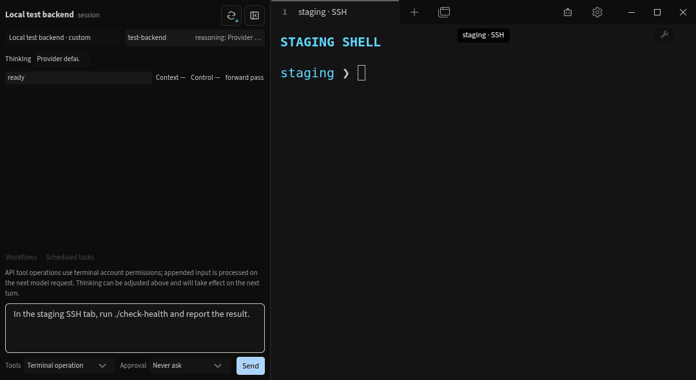
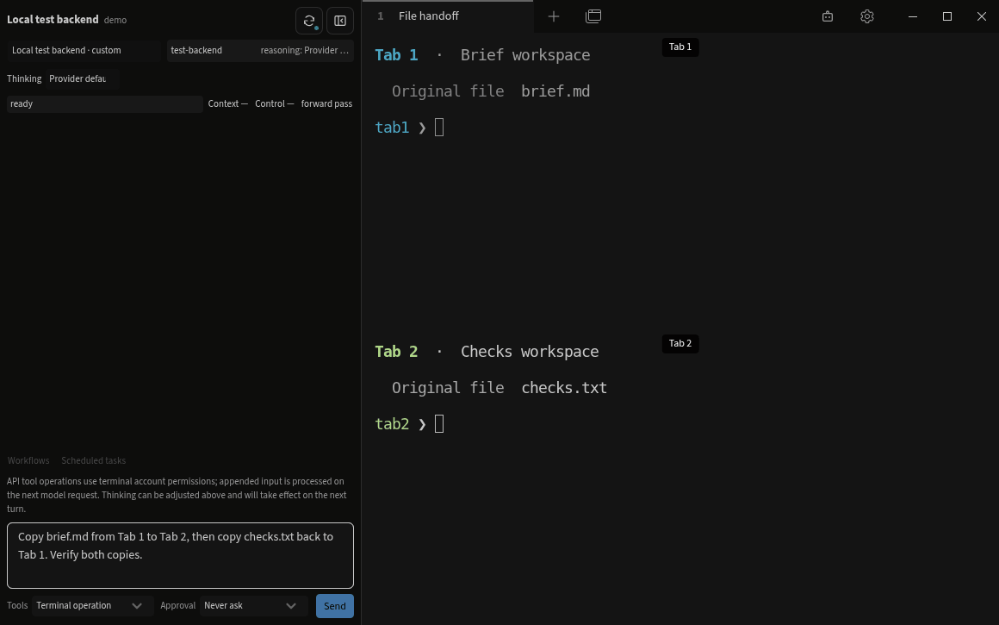

<h1>Tabby AI Tools</h1>

在 Tabby 的 AI 侧栏操作本地和 SSH 终端，从执行一条命令到协作处理多台服务器。

[主要功能](#主要功能) · [操作演示](#操作演示) · [快速开始](#快速开始) · [模型连接](#模型连接) · [使用指南](docs/guide.md) · [发布说明](https://github.com/Hanlen/tabby-ai-tools/releases) · [English](README.md)

<picture>
  <source media="(prefers-reduced-motion: reduce)" srcset="https://raw.githubusercontent.com/Hanlen/tabby-ai-tools/main/docs/assets/robot-multitask.png">
  
</picture>

## 主要功能

- **操作本地和 SSH 终端。** 可以使用单个终端，也可以跨多个标签页或分屏协作。AI 在指定终端读取输出、运行命令，并根据结果判断下一步。 [多终端协作](docs/guide.md#任务编排与多服务器协作)
- **与正在运行的程序交互。** 向支持的前台程序发送文本和按键，包括终端中运行的 AI Agent。可以设置只读或操作审批，点击「停止」中断 AI 回合，点击「释放」取回终端输入权。 [终端控制](docs/guide.md#标签访问与终端控制)
- **通过已有 SSH 会话传文件。** 粘贴或拖入文件、截图后可让 AI 上传，也可以让它从远端下载文件。目标标签页显示进度，插件用 SHA-256 校验传输结果。 [文件传输](docs/attachments.md)
- **录制并复用工作流。** 用 `/remember` 开始录制命令和验证步骤，完成后设置别名，下次直接发送 `/check-app` 之类的命令。流程可执行预设检查，也能在需要时交给 AI 判断。 [工作流](docs/task-workflows.md)
- **设置定时 AI 任务。** 在对话中说明执行时间、检查目标和异常处理规则，支持单次、按间隔或每日执行。用 `/schedules` 查看记录或暂停。任务在 Tabby 打开时运行。 [定时任务](docs/scheduled-tasks.md)
- **查看记录并恢复会话。** 展开工具调用查看执行过程，用 `/resume` 恢复当前目录的历史会话，也可开启任务终端日志，供以后查看和搜索。 [会话历史](docs/guide.md#工作目录与线程) · [终端日志](docs/terminal-logs.md)
- **通过 MCP 接入外部 AI。** 在 AI Tools 设置中启用本地 MCP 服务，兼容的客户端即可读终端输出并向 Tabby 发送输入。 [MCP 配置](docs/mcp.md)

## 操作演示

### 在 SSH 终端运行命令

先在 Tabby 打开一个 SSH 标签页，再打开 **AI Tools**。发送下面的指令，把 `staging` 换成你的 SSH 标签页名称。若出现审批，确认后执行。

> 在 `staging` SSH 标签页执行 `pwd`，然后告诉我结果。

<picture>
  <source media="(prefers-reduced-motion: reduce)" srcset="https://raw.githubusercontent.com/Hanlen/tabby-ai-tools/main/docs/assets/ssh-command-demo.png">
  
</picture>

*实录通过 Tabby 的真实 SSH 连接在回环测试服务器上执行 `./check-health`。侧栏使用本地测试后端，从 Shell 读回 HTTP 200 并报告结果。*

另一个例子 · 两个标签页双向交接文件

<picture>
  <source media="(prefers-reduced-motion: reduce)" srcset="https://raw.githubusercontent.com/Hanlen/tabby-ai-tools/main/docs/assets/two-terminal-demo.png">
  
</picture>

*这段 6 秒实录使用本地测试后端。AI 将 `brief.md` 从 Tab 1 复制到 Tab 2，再将 `checks.txt` 复制回来，最后核对两份副本。*

## 快速开始

1. 在 [Tabby](https://github.com/Eugeny/tabby) 打开 **设置 → 插件**，安装 `tabby-ai-tools` 后重启。
2. 点击机器人图标打开 **AI Tools**。选择已有连接，或在 **设置 → AI Tools → 连接与模型** 中添加。
3. 打开需要使用的终端，在侧栏描述任务，按 **Ctrl+Enter** 或 **Cmd+Enter** 发送。

## 模型连接

在侧栏切换连接，用 `/model` 选择模型和它支持的推理强度。

| 连接方式 | 配置 |
| --- | --- |
| **ChatGPT 订阅 → Codex CLI** | 安装 Codex CLI，运行 `codex login`，用有 Codex 权限的 ChatGPT 账号登录，然后选择 **Codex（本机登录）**。此模式使用 ChatGPT 账号权益。 [Codex 登录说明](https://learn.chatgpt.com/docs/auth#codex-cli) |
| **Claude Code 本机登录** | 安装 Claude Code。使用独立会话空间时，在 AI Tools 生成该空间的登录命令，在本地终端完成登录，再检查并重连。 [Claude Code 配置](docs/claude-code.md) |
| **OpenAI、DeepSeek、GLM、Claude API** | 在 AI Tools 添加对应供应商，填写 API Key 和模型 ID。 |
| **Kimi、阿里云 Coding Plan 或自定义服务** | 选择供应商预设，或填写自定义服务地址和模型。 [Coding Plan 配置](docs/coding-plans.md) · [Pi 和自定义连接](docs/pi.md) |

[开发说明](docs/development.md)
