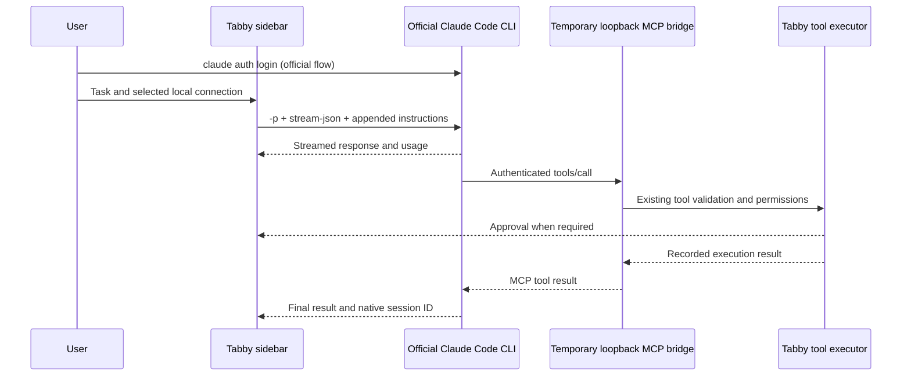

# Claude Code local login

[README](../README.md) · [中文使用指南](guide.md)

This development change adds **Claude Code (local login)** alongside native Codex and the existing Claude API connection. It runs the user's installed, unmodified official CLI. Authentication, model access, subscription limits, and billing remain with Claude Code.

## Setup

1. Install the [official Claude Code CLI](https://code.claude.com/docs/en/setup) on the computer running Tabby.
2. Run `claude auth login` in a local terminal and choose your Claude account to use an eligible subscription. Check `claude auth status` and confirm the intended authentication method. Existing API keys, API key helpers, or cloud-provider configuration may select separately billed usage; the plugin preserves the CLI's authentication options.
3. In **Settings → AI Tools → Claude Code**, set the executable path if discovery cannot find it. Select **Claude Code (local login)** in the sidebar or make it the default connection. The default alias is `sonnet`; `opus`, `haiku`, and full model IDs can also be configured. These are candidate aliases, not an account entitlement list.
4. Describe a task. Operations use the same Tabby tools, read-only restrictions, approvals, workflow checkpoints, and execution records as API connections. The host's operating system permissions still apply; this mode does not supply an OS sandbox.

The executable resolver checks PATH, the official `~/.local/bin` location, common Homebrew/npm directories, and the current executable's directory. Explicit paths, quoted paths, and `~/` paths are supported. A custom command name searches PATH only. Windows `.exe`, `.com`, `.cmd`, and `.bat` launchers are supported. Custom Node/npm prefixes outside these locations need an explicit path and a working Node environment.

Connecting checks `--help` and `auth status` without model inference. The CLI must support the integration flags, including `--system-prompt-snapshot`, `--append-system-prompt-file`, strict MCP configuration, and streaming partial messages. Update Claude Code if the connection reports a missing flag. No account credentials are read from files or saved by the plugin.

## Design decision and official sources

The [official authentication rules](https://code.claude.com/docs/en/legal-and-compliance#authentication-and-credential-use) distinguish running unmodified Claude Code with the user's own subscription from a third-party application's reuse of subscription credentials. The integration uses the former: the CLI completes Anthropic's own login flow and makes all model requests. The plugin neither implements a Claude.ai OAuth flow nor forwards subscription tokens to the Messages API. Existing Claude API connections remain separate.

The adapter uses the documented [programmatic CLI](https://code.claude.com/docs/en/headless), [CLI flags](https://code.claude.com/docs/en/cli-reference), and [HTTP MCP configuration](https://code.claude.com/docs/en/mcp). A TypeScript Agent SDK dependency is not needed. The default Claude Code system prompt is retained, with the bundled Tabby skill and current task instructions appended.

## Runtime boundaries

- Each invocation gets an HTTP MCP listener on `127.0.0.1` with a random port and a fresh 256-bit bearer secret. The listener checks the host and rejects browser origins. Calls are serialized before entering the existing executor; intent is saved before execution. The server and private temporary instruction/config files are removed when the invocation ends or stops.
- `--tools ""` disables built-in shell/file tools. `--strict-mcp-config` loads the Tabby bridge, and `--disable-slash-commands` disables CLI skills and commands for this invocation. `--settings '{"disableAllHooks":true}'` disables user/project/plugin hooks; administrator-managed hooks and enforced policy remain governed by Claude Code. Only user settings are loaded to retain the user's authentication helpers; project/local settings are excluded. These options apply to the launched session, without changing the user's settings files.
- MCP approval rules allow the bridge to reach the host executor. They do not waive the host's read-only checks, mutation approval, workflow sequencing, sudo authentication, or scheduled-task restrictions.
- The plugin stores portable conversation history and an opaque native session ID, not credentials. Successful continuations use `--resume` and send only new input. Model changes and provider switches import portable text and observed tool outcomes into a fresh session. On an interrupted or failed invocation, the next explicit request reconstructs from recorded history, with a warning to verify the terminal before acting. There is no automatic model retry or silent API fallback.
- Stop cancels pending host requests and terminates the owned CLI process tree before the turn finishes. Commands already submitted to a Tabby terminal may still run. Messages added while Claude Code is working are queued for a new invocation after the current one ends, rather than injected into an in-progress CLI request.
- Observed usage is counted once per native message and checked against the task budget before further operations. Token usage is not a subscription balance or price. Native context compaction belongs to Claude Code; imported plugin history has a 9 MiB input limit.
- Schedules can choose this connection. Existing scheduler isolation, logging, and unattended rules apply. An explicitly requested candidate-model test uses an isolated MCP confirmation tool and consumes model quota; normal connection/model-list checks do not.

## Validation limits

Offline tests use a real child process and authenticated HTTP MCP, with simulated Claude events. They cover streaming, native resume, migration, approvals, read-only mode, durable intent, cancellation, malformed/truncated output, failed results, token accounting/budgets, connection selection, and the scheduler's model probe. They make no model requests.

A real subscription end-to-end run still requires an installed CLI, an eligible user's official login, and real Tabby desktop testing. Passing the offline tests does not establish actual subscription entitlement, model quality, or Windows/macOS execution results.
