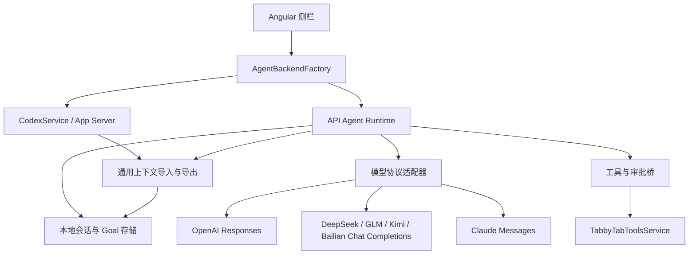

# 多模型 Agent 设计与评审

v0.4.1 新增自定义 OpenAI 兼容连接（`provider: custom`）：`apiFormat` 显式选择 Chat Completions（缺省）或 Responses，不按模型名或 URL 推断协议。复用统一 Agent 工具循环、模型发现和上下文转换，不发送厂商专用 Thinking／缓存字段。可选直接 Key、环境变量或无认证；无认证模式不发 Authorization。历史指纹为自定义连接增加协议字段，保留既有供应商指纹。切换协议时导入通用文本和目标，避免将原生工具历史发到另一协议。配置与限制见[使用指南](guide.md#自定义-openai-兼容接口)。

状态：设计评审完成，第一版已按下述范围实现。2026-10-17。

## 产品目标

同一 Tabby 侧栏支持现有 Codex 登录，以及 DeepSeek、GLM、Kimi、OpenAI、Claude 的商业 API，以及 Kimi／百炼 Coding Plan。API 模式无需安装 Codex。保留流式回复、终端读取与操作、人工审批、按目录恢复历史、任务目标和停止操作。

提供多个连接配置，每个配置有独立名称、供应商、Base URL、模型 ID、密钥来源和模型参数。面板选择连接后再开始会话。切换连接需要当前任务结束；API 连接之间及 API/Codex 双向切换时携带当前对话的通用文本上下文和目标，修改端点或模型也保留上下文。历史按目标配置另存快照，禁止把一个供应商的推理块直接交给另一个供应商。

## 架构

模型适配器只负责请求、流式解析、工具参数与结果编码、用量和供应商原始消息。API Runtime 负责工具循环、生命周期、持久化、中断和预算。UI 负责展示与回答审批，不处理供应商 HTTP 协议。

现有 `CodexService`、CLI 发现与进程回收保持独立。引入明确的 `AgentBackend` 接口。为控制迁移风险，第一版复用面板已有的线程、回合、请求与事件形状作为内部桥；它是 UI 兼容层，供应商适配器不依赖 Codex RPC，也不假装远端 API 提供 App Server。后续可逐步将 UI 桥替换成通用事件。

## 模型协议

| 配置 | 初始协议 | 必须处理的差异 |
| --- | --- | --- |
| Codex | 现有 stdio RPC | 原有 Goal、steer、沙箱与账户额度 |
| OpenAI API | Responses | 带类型的 SSE、function_call/output、reasoning items |
| DeepSeek API | Chat Completions | reasoning_content 回传、分片 tool_calls、Thinking 参数 |
| GLM API | Chat Completions | reasoning_content 回传、Thinking 参数与不同端点 |
| Kimi API / Coding Plan | Chat Completions | 独立国内／国际端点和 Key、思考模型差异、reasoning_content、会话级缓存标识 |
| 百炼 Coding Plan | Chat Completions | 国内／国际套餐端点、专用 Key、enable_thinking；不走 Responses |
| Claude API | Messages | content blocks、tool_use/tool_result、stop_reason、thinking signature |

不把所有供应商简化成替换 Base URL。Kimi 与百炼预填官方模型示例，模型 ID 仍由用户配置，不限制手动输入。参数按供应商和模型显式选择，未知能力使用保守值。原始 reasoning blocks 保存在所属会话中，工具续轮时原样回传；默认 UI 不显示内部推理。

API 请求由本机 Node 网络层执行，避开浏览器 CORS 和把密钥混入页面状态的问题。支持 HTTPS、自定义端点与明确允许的本地 HTTP 测试端点；跨域重定向不携带密钥。实现必须兼容 Tabby 实际宿主 Node/Electron，不能只依赖构建机的 Node 20。

## API Agent 执行循环

1. 固定本回合的连接、模型、策略和预算快照，保存用户输入。
2. 组织系统提示、该配置的历史、终端增量和工具定义，发起流式请求。
3. 实时推送正文。按 call ID/index 拼接工具参数，只有收到完整且合法的工具调用后才执行。
4. 参数校验，进入权限判断，必要时等待用户审批，再调用本机工具。
5. 保存原始 assistant 消息和每个工具结果；保留调用与结果的对应关系。
6. 将结果交回同一模型，继续循环，直到正常结束、中断、失败或达到循环/预算上限。

工具循环上限设为 0 表示不设固定轮数，新连接默认使用 0；已有配置保留显式上限。有限模式只计算含工具调用的请求，额外允许收尾请求读取最后结果、更新一次本地 Goal 并回复（最多两次模型请求）；收尾阶段即使返回终端工具调用也禁止执行，未完成 Goal 不会标记成功。`read_tab.waitMs` 支持最多 30 秒的可取消等待，读取 AI 控制中的终端默认等待 1 秒，减少即时轮询。

`api-loop-guard.ts` 独立检测最近 96 次调用中周期不超过 32 步、连续重复三次的调用及结果序列。参数和 JSON 结果规范化，等待时长及纯说明字段不影响匹配；终端追加和滚动输出按新增文本比较。活跃/未知进程的静止画面清空重复序列，发送回执本身不作为无进展证据。检测触发后禁用其余工具，补齐同批工具结果配对，保留一次无工具总结请求并将 Goal 标为 blocked。调用指纹和终端比较基线随会话持久化，恢复时可在执行前阻止同一循环的下一条写操作；新 Goal 清空，正常回合结束清理。此检测不推断语义等价，也不读取模型内部思考。

同一会话同时只允许一个回合。工具执行串行，避免同一终端发生并发写入。输出长度受限。工具异常作为结果返回，网络或解析失败结束本回合并保留已完成记录。第一版不自动重试已经产生输出或执行工具的回合，避免重复动作。

运行中追加指令：Codex 保留原生 steer；API 模式在下一次模型请求前消费输入队列。面板显示“已排队，下轮处理”，不把排队误称为实时中断当前生成。终端自动转发沿用相同边界，只有进入 Runtime 队列后才确认接收游标。

停止：取消 HTTP 流、阻止后续工具、取消待审批请求，保存 interrupted 状态。已经发送到终端的命令可能继续运行；UI 必须明确说明，不能把断开 HTTP 当作终端进程已退出。

## 工具与权限

第一版复用 `tab-tools.ts` 的工具：列出标签、读取标签、切换标签、发送终端输入、释放终端、操作普通标签控件。供应商使用扁平函数名，桥接回现有工具名。另提供本地 Goal 状态更新工具。

API 模式可经终端完成读写文件、运行测试等工作。独立的文件编辑器与隔离命令执行器列为后续扩展；不承诺拥有 Codex 内置文件工具与 OS 沙箱。

API 模式的“只读”禁止发送输入及操作控件；有副作用的终端操作根据审批策略询问。工作目录可写不是对任意 Shell 的可靠隔离：API UI 显示实际的工具策略，并明确终端命令使用该终端账户权限。终端接管不再单独询问用户；模型保留需要的任务，并可自动中断已检测到的无关进程。

## 配置、凭据与会话

- 保留 `codexAgent` 配置键，新增 API profiles 与默认 profile；旧配置自动继续使用 Codex。会话文件有独立版本号。
- 普通配置保存供应商、URL、模型、上下文窗口、最大输出、Thinking 配置及密钥来源；用户选择“直接输入”时也保存 API Key，设置页使用密码框并说明本地存储位置。
- 密钥支持直接输入、环境变量和 Tabby Vault。新连接默认直接输入；旧配置沿用原有环境变量或 Vault 来源，读取失败时不自动切换来源。
- 本地会话保存于 Tabby 配置目录下独立子目录，使用随机 ID 和原子文件替换。配置文件只保存恢复索引。
- 会话归属由 profile ID 和 cwd 共同确定；模型、端点或供应商变化后，以通用 user/assistant 文本创建新快照，保留正文、终端转发与工具记录、UI 回合历史、目标和累计用量。工具调用及结果转成有标记的历史文本，不重放；原始推理内容留在原快照中。同配置重连继续原会话，不转换原生消息。不同工作目录不自动迁移上下文。
- Codex 导出同时读取继承上下文与原生分页回合。导入通过 `thread/start.developerInstructions` 设置带有明确数据边界的历史文本，并在 `codex-contexts` 下原子保存显示历史及 Goal 基线，重启前未生成原生消息时也可重建。进行中目标先以原生 paused 状态持久化；UI 保留逻辑 active 状态，显式回合被接受后才激活，防止切换连接触发自动推理。配置与历史准备失败时恢复原连接及两类历史索引。
- 原始消息与 UI 历史分开存储。恢复时将未完成回合标记 interrupted；不自动重放工具，也不把未配对的 tool call 发给 API。

## 状态展示

顶部显示供应商与模型。模型选择使用当前配置中的模型 ID；设置页允许手动填写和多个配置。

所有连接的模型浮窗统一先选模型，再选 reasoning。API /models 上报等级优先；缺失时使用 `model-reasoning.ts` 中已知模型的保守等级，未知模型保留默认及手动输入。手动模型 ID 同样进入第二步。模型和等级一起保存、沿已有上下文交接路径应用；选择非空等级会重新开启已关闭的 Thinking。DeepSeek 顶部保留 Thinking 开关，开关修改直接更新下一回合的配置快照，无需重连。协议层持续转发正文增量及不包含原始思考文本的思考接收进度；侧栏显式刷新 Node 回调产生的变化。设置页“测试连接”使用同一配置规范化与流式协议层发送简短无工具请求，在对应卡片显示进度、结果、取消和超时。

Codex 状态保留账户额度。API 模式显示模型用量和本地累计，不伪造“5 小时额度”“普通用量”等订阅信息。未提供上下文窗口时显示未知；上次请求输入占用与已上报累计 tokens 分开，tokens 统计不等同于货币计费。预算按已上报用量在请求边界检查，是软上限；在途请求可能超出，未上报用量无法计入。第一版不自动压缩历史，长对话需新建会话。

Goal 由本地 Runtime 持久化。一次模型请求结束只表示回合结束；只有明确的 Goal 完成报告才能显示目标完成。工具调用可在同一回合内持续执行，用户可配置有限轮数；模型正常结束后不自动启动新回合，未完成目标保留“继续”按钮。

## 评审结论

| 问题 | 结论与实施修正 |
| --- | --- |
| API Key + Base URL 是否足够？ | 不够。增加 Runtime 和三个协议适配器，处理原始推理历史。 |
| 一开始重写整个 UI？ | 风险过大。先建立 Backend 接口与明确的 UI 兼容桥，复用已测试的面板。 |
| 每个面板能否选不同供应商？ | 可以。Backend 绑定面板配置；禁止用全局可变客户端切换供应商。 |
| 未装 Codex 是否能用 API？ | 可以。API 默认配置不得触发 CLI 启动或错误重试。 |
| 现有 sandbox 能否直接复用？ | 不能。API 只实施真实可执行的工具限制与审批，不宣称有 OS 沙箱。 |
| 中断/崩溃后能否自动重试工具？ | 不自动重放；保存中断记录和完整工具配对，避免重复命令。 |
| 原生 steer/额度/Goal 是否通用？ | 分别映射为输入队列、本地 usage、本地 Goal；UI 按能力显示。 |
| 第一版必须有独立文件编辑工具吗？ | 本轮通过 Tabby 终端完成操作，文件编辑工具是后续扩展。 |
| SDK 或编排框架如何选择？ | 先用小型类型化协议层与 Node HTTP 流，减少 Electron 版本及打包依赖；不引入大型 Agent 框架。 |

按此评审后的方案实施。该范围包含四家 API 的实际工具循环与设置入口，不仅是模型聊天。

## 实施后复查

- `agent-types.ts` / `agent-backend.service.ts` 定义 Backend 边界和面板配置隔离；Codex 仍由原服务提供。
- `api-provider.ts` / `api-transport.ts` 实现三个协议及 SSE；OpenAI 保留 encrypted reasoning，Claude 保留签名，DeepSeek/GLM 保留 reasoning_content。
- `api-agent.ts` 管理工具循环、审批、排队输入、预算和取消；`agent-store.ts` 用原子文件替换保存版本化历史。
- 修正旧工具异步完成后回错 Backend、停止后延迟发送终端输入、等待 Vault 阻塞停止等边界，补充回归测试。
- 本机 158 项测试中 153 通过，5 项 Windows 专用测试跳过；类型检查和构建通过。真实 API 与桌面验证边界详见 [验证记录](../VALIDATION.md)。
- 后续按用户要求支持直接填写 API Key，并通过 `agent-context.ts` 在 API 连接间迁移通用上下文；新连接先完成上下文准备，再切换侧栏，恢复失败时回到原连接。本次共 179 项测试中 174 通过，5 项 Windows 专用测试跳过，类型检查和构建通过。

## 验收

- 旧 Codex 测试、类型检查、生产构建继续通过。
- 四家协议分别验证流式正文、工具分片、结果回传、用量、错误与取消。
- 至少验证两个连续工具轮次，包含 DeepSeek/GLM reasoning_content 与 Claude thinking blocks 的无损回传。
- 覆盖只读拒绝、审批接受/拒绝、循环上限、预算边界、请求中追加输入。
- 覆盖配置隔离、重启恢复、未完成回合恢复、损坏文件不被覆盖和密钥不进会话文件。
- 无 API Key 时使用本地 HTTP 夹具完成协议测试；真实供应商连通性与桌面 UI 验证需明确区分，不能用夹具结果代替真实验证。

## 官方依据

以下为 2026-10-17 查阅的官方文档。架构及范围是本项目的设计决策。

- [OpenAI Function calling](https://developers.openai.com/api/docs/guides/function-calling)：应用执行函数并回传结果，Responses 工具协议。
- [DeepSeek Thinking Mode](https://api-docs.deepseek.com/guides/thinking_mode/)：Thinking 与工具调用中的 reasoning_content 保留。
- [GLM OpenAI API 兼容](https://docs.bigmodel.cn/cn/guide/develop/openai/introduction)：Chat Completions 兼容端点，仍存在参数差异。
- [GLM 思考模式](https://docs.bigmodel.cn/cn/guide/capabilities/thinking-mode)：交错思考及保留式思考的历史回传要求。
- [Claude Tool use](https://platform.claude.com/docs/en/agents-and-tools/tool-use/how-tool-use-works)：客户端工具执行循环与 stop_reason。
- [Claude Thinking](https://platform.claude.com/docs/en/build-with-claude/thinking)：Thinking 块与签名的保留要求。

## Claude Code 本机引擎

开发版新增内置连接 `claude-code`，使用独立的 `claudeExecutable`、`claudeModel`、`claudeReasoningEffort`、`claudeThreads` 配置。它复用会话存储和面板事件端口，但模型循环由官方 CLI 执行，Tabby 工具经临时认证 MCP 回到原有执行器。`runtime: claude-code` 的 profile 是本机元数据，不是可发往 Anthropic HTTP API 的连接。Claude API Key 接入继续保持独立。完整研究、边界、恢复与限制见 [Claude Code 接入方案](claude-code.md)。

## Goal continuation and effort capability sources

API and Claude Code share the same active-goal continuation loop in `api-agent.ts`. A text response is persisted and followed by a continuation prompt while the goal remains active; provider-native tool/reasoning history stays intact. Completion, a real blocker, an explicit pause, cancellation, budget exhaustion, an explicitly configured tool cap or repeated no-progress evidence ends continuation. No fixed conversational-turn cap is added. The legacy default of 20 tool rounds migrates to zero; `toolRoundLimitConfigured` preserves newly explicit 20-round limits.

Reasoning metadata from `/models` takes priority. Fallback menus use conservative documented subsets; unknown/custom models retain provider defaults and manual values. Source references (checked 2026-10-24):

- [OpenAI reasoning](https://developers.openai.com/api/docs/guides/reasoning) and [GPT-5](https://developers.openai.com/api/docs/models/gpt-5).
- [DeepSeek model metadata](https://api-docs.deepseek.com/api/list-models/).
- [GLM thinking and effort](https://docs.bigmodel.cn/cn/guide/capabilities/thinking).
- [Claude effort](https://platform.claude.com/docs/en/build-with-claude/effort) and [Claude Code model settings](https://code.claude.com/docs/en/model-config). Alias resolution and CLI support remain account and installation dependent.

Kimi 与百炼 Coding Plan 的端点、区域、模型和套餐边界见 [Coding Plan 配置](coding-plans.md)。三种新连接沿用通用 Agent 工具循环；Kimi 以持久会话 ID 作为 `prompt_cache_key`，确保工具续轮、后续回合及重启恢复稳定。客户端标识为真实产品名，不冒用已获准的其他工具。
