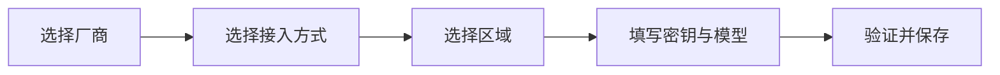

# Provider 配置改版与每周接入计划

制定日期：2026-10-25。状态：待实施的产品与开发计划。

优先级调整（2026-10-25）：先实现用户自定义的 OpenAI 兼容入口。v0.4.1 已增加 Chat Completions／Responses 显式选择、手动 Base URL／模型、直接密钥／环境变量／无需密钥、模型发现、工具循环与历史兼容；实际验证结果见 [v0.4.1 发布说明](releases/0.4.1.md)。其余向导改版、Provider 定义集中化和新增厂商仍按下文作为待实施计划，不因本次兼容入口而视为完成。

[开发文档](development.md) · [现有 API 配置](guide.md#api-密钥与切换模型) · [Kimi 与百炼套餐配置](coding-plans.md)

## 决策与目标

调整设置页的信息组织，保留现有“连接列表＋连接详情”布局。新增连接改成“选择厂商 → 选择接入方式 → 选择区域 → 配置密钥和模型 → 验证并保存”。让普通用户无需理解接口协议和端点路径，也让使用代理、环境变量和自定义模型的用户可以继续配置。

目标节奏为**每周接入一家 Provider**。这里按厂商或服务平台计数，同一家厂商的模型、国内／国际区域、普通 API 和编程套餐不分别凑数。每周明确支持范围，并区分本地协议测试、真实账号验证和正式发布。

本文件记录计划，不表示设置页已改版，也不建立自动开发、提醒、定时调用模型或自动发布任务。首周暂定从下一个周一 **2026-10-26** 开始；日期为目标排期，按每周实际验收更新。

## 现状与需要解决的问题

依据当前 `src/settings.pug`、`src/settings.ts`、`src/agent-types.ts`、`src/api-provider.ts`、`src/api-models.ts` 和 `src/agent-store.ts`：

| 现状 | 对用户或后续开发的影响 | 调整方向 |
| --- | --- | --- |
| 已有 7 个 API 供应商选项，另有 Codex、Claude Code 本机入口 | 同一列表同时出现厂商和套餐，后续选项会持续增长 | 厂商作为第一层，API／套餐／本机登录作为第二层 |
| “添加 API 连接”立即创建空白 OpenAI 配置 | 新用户先面对与目标厂商无关的表单，取消后可能留下空连接 | 先在草稿中选择厂商，保存后再创建连接 |
| Kimi、百炼已有区域选择，其他连接主要靠填写 Base URL | 用户需要自行辨认地区、产品、Key 和接口路径 | 用厂商自己的产品和区域预设，按需开放自定义地址 |
| 当前设置会逐项自动保存，应用配置还需连接操作 | “已保存”和“当前运行中”容易混淆 | 明确区分草稿、已保存和当前生效的连接 |
| 模型发现、连接测试和运行能力属于不同检查 | 获取到模型不代表工具调用、账号准入或套餐扣费已经通过 | 分别显示检查结果、范围与时间 |
| URL、环境变量、展示名称、模型等级和协议分支分布在多个文件 | 每周增加一家容易遗漏配置项，或误用其他厂商的参数 | 建立统一 Provider 定义，共用界面与协议测试契约 |

已有 Kimi API、Kimi Coding Plan 和百炼 Coding Plan 属于开发版适配：本地测试、构建和打包已验证，真实账号准入及额度扣减仍待验证。GLM Coding Plan 尚缺专项验证；阿里普通按量 API 尚无独立预设。这些状态需要在路线图中保留，不能统一标成“全面支持”。

## 设置页方案

### 页面分区

| 区域 | 主要内容 | 交互要求 |
| --- | --- | --- |
| 顶部 | 默认连接、添加连接 | 添加按钮改为“添加连接”，同时容纳 API 与本机方式；切换默认连接是独立操作 |
| 左侧 | 已保存连接、搜索、厂商分组 | 显示连接名、厂商、接入方式、区域、模型和默认标记；同一家允许多套配置 |
| 右侧 | 当前连接详情或添加向导 | 默认只显示完成配置所需字段；协议、输出上限和工具限制折叠 |
| 通用设置 | 启动行为、语言、权限与预算 | 与具体模型配置分开，避免用户误以为它们只对一家生效 |
| 独立管理入口 | 任务流程与偏好、定时任务 | 保留现有功能，不再作为模型厂商的同级选项呈现 |

第一阶段只调整连接配置的信息层级和导航；不重写任务管理、审批或会话运行器。沿用 Tabby 主题、现有字号和组件，不引入独立字体、营销页面或新的 UI 框架。

### 添加连接的流程

1. **选择厂商**：可搜索 Google、MiniMax、Kimi 等名称，展示当前版本已经实现的条目。计划中的厂商在路线图中查看，不进入可用列表。
2. **选择接入方式**：按厂商实际提供的方式展示“普通 API”“编程套餐”或“本机登录”。厂商的 Coding Plan、Token Plan、M Plan 保留官方名称，旁边解释用途与计费来源。没有的方式不提供入口。
3. **选择区域**：使用各厂商自己的地区名称和端点；只有一个可用地区时无需强制多走一步。国内／国际并非所有厂商的统一二选一模板。自定义地址作为可选项保留，不按 IP 或语言擅自切换区域。
4. **填写密钥和模型**：默认显示直接输入 Key、模型选择及可读的连接摘要。环境变量、自定义 Base URL、手动模型 ID 均可使用。本机登录显示 CLI 路径与登录状态，不要求 API Key。
5. **验证并保存**：摘要显示厂商、接入方式、区域、模型和计费来源。可以直接保存为“未验证”，也可以主动执行测试后保存。测试前明确提示会产生模型用量；不把测试当成保存的前置条件。

新连接向导中的每一步保留草稿，返回上一步不会丢失密钥或模型。取消添加不创建连接；已有连接在编辑期间显示未保存状态，切换或关闭时可以保存、放弃或返回。不会因为切换编辑对象就修改默认连接。

更换厂商通过新建连接处理；同一连接的区域、模型和端点可以编辑。修改区域或产品后清除旧检查状态，提示重新核对 Key，不静默尝试其他区域、厂商或计费方式。

### 连接详情与检查结果

详情按“基本配置、身份验证、模型、验证结果、高级参数”排列。明确标记“已保存”“有未保存修改”“当前已应用”；任务运行期间不自动重连，待任务结束后由用户应用新配置。

| 操作／状态 | 实际证明什么 | 不应作出的推断 |
| --- | --- | --- |
| 本地格式检查 | 必填项、端点协议和路径等配置有效 | 不代表 Key 有效或账号有权限 |
| 获取模型 | 当前接口返回模型列表；不支持列表时允许手动填写 | 不代表该模型能完成工具调用 |
| 测试连接 | 真实简短请求完成、流式返回有效 | 不代表连续工具调用或套餐扣费已验证 |
| 测试工具能力 | 隔离的无害工具往返验证通过 | 不代表真实终端／SSH 的端到端验证通过 |

结果附带被测试的连接配置、时间和失败原因；密钥、模型、产品、区域或端点变化后使相关结果失效。认证失败、无权限、配额不足、模型不支持、超时分别给出对应处理建议。套餐余额只有存在经过适配的官方查询接口时才展示；模型 token 使用量不能冒充套餐剩余额度。

表单必须保留可见标签、帮助文本、键盘操作和错误后的恢复入口。窄窗口转为单列，长厂商名、长模型 ID 和翻译文本可换行；状态同时使用文字，不能只靠颜色。

## 可持续扩展的实现结构

新增统一 Provider 定义文件，集中维护以下信息：

| 定义 | 用途 |
| --- | --- |
| 厂商 ID、显示名称、官方帮助链接 | 厂商选择、分组与文档入口 |
| 接入方式及套餐名称 | 区分普通 API、订阅套餐和本机登录 |
| 产品下的区域和默认地址 | 匹配正确端点，保留代理和手动覆盖 |
| 密钥来源与环境变量建议 | 同一产品的表单默认值和说明 |
| 默认模型示例和能力发现方式 | 模型列表、手动输入及已知能力提示 |
| 协议适配器及参数转换 | Responses、Chat Completions、Messages 或厂商原生协议 |
| 模型级限制和验证能力 | Thinking、reasoning、工具调用、usage、历史签名等差异 |

厂商、产品、区域和传输协议在概念上独立：百炼托管的 Kimi 模型仍使用百炼参数；不能仅凭模型名、URL 或“OpenAI 兼容”就套用另一家的适配器。界面使用定义生成表单，复杂的流式和工具协议保留明确的适配逻辑。

先为现有配置增加读取映射，第一阶段继续兼容 `provider=kimi-coding`、`bailian-coding` 等已有值。既有连接 ID、默认连接、密钥来源、自定义地址与模型不重置。当前历史指纹包含 provider、端点和模型，因此不能只为统一命名就改写这些字段；后续如需持久化结构迁移，必须版本化并验证迁移前后的历史恢复和回退。

“通用兼容接口”作为专家入口，明确选择 Chat Completions／Responses／Messages；只声明经过实现和验证的协议能力，不自动承诺未知供应商的完整支持。首周优先完成 Provider 定义和已有协议复用，复杂自定义 Header、动态插件系统及模型市场不列入第一阶段。

## 每周接入排期

排序根据终端编程场景、现有用户套餐需求、覆盖面和现有适配器复用程度制定，是本项目的实施优先级，不是模型质量排名。

| 周次 | 目标日期 | Provider | 本周交付范围与主要关注点 |
| --- | --- | --- | --- |
| 第 1 周 | 10-26 ～ 11-01 | **MiniMax** | 普通 API 与当前编程订阅入口；核对国内／国际产品、鉴权和 Thinking。同步落地 Provider 定义、添加连接草稿、产品和区域选择；迁移现有连接展示 |
| 第 2 周 | 11-02 ～ 11-08 | **字节跳动／火山方舟** | 豆包按量 API 与 Coding Plan；核对产品对应端点、模型标识与工具调用。海外产品独立核对，不把国内 Key 或模型直接套入海外 |
| 第 3 周 | 11-09 ～ 11-15 | **Google Gemini** | 首批限定 Gemini Developer API；验证模型发现、流式、工具往返和思考签名保存。单独评估兼容层能否完整承载状态；Vertex AI 与账号订阅登录另排范围 |
| 第 4 周 | 11-16 ～ 11-22 | **腾讯** | 混元相关 API 与 TokenHub Token Plan；核对官方当前平台、套餐与区域端点，以及聚合模型的参数差异 |
| 第 5 周 | 11-23 ～ 11-29 | **xAI／Grok** | Grok API；按当周官方文档选择协议并验证 Responses、工具历史及错误处理，不把聊天订阅当 API 凭据 |
| 第 6 周 | 11-30 ～ 12-06 | **Mistral AI** | Mistral API，包含账号可用的编程模型；核对模型列表、流式工具调用和推理能力，不默认承诺其客户端订阅可转为 API 使用 |
| 第 7 周 | 12-07 ～ 12-13 | **百度千帆** | 按量 API 与当期 Token Plan；分别核对当前产品、专用 Key、端点和模型范围，旧 Coding Plan 只按官方兼容规则处理 |

同一家在该周包含多个接入方式，但每个方式分别记录验证结果。官方不提供的区域或套餐无需补齐；实际无法完成的范围要明确顺延，不能因为添加了下拉选项就算完成。

现有厂商维护持续进行：优先修复现有回归；补做 Kimi／百炼真实验证、GLM Coding Plan 专项适配，并评估阿里普通 API／Token Plan。上述工作不算新增厂商周的数量。每周开工前复核容量；如果基础改造或严重回归超出容量，应调整排期并记录原因，不能削减工具调用与历史兼容验收。

### 每周工作节奏

| 时间 | 工作 | 可检查的结果 |
| --- | --- | --- |
| 周一 | 官方文档、区域／套餐／Key／协议确认，锁定本周范围 | 更新接入矩阵、风险和所需测试账号；未具备账号也明确记录 |
| 周二 | Provider 定义、预设和表单，完成最小文本流式链路 | 可配置的开发版连接和基础协议夹具 |
| 周三 | 思考参数、连续工具调用、usage、取消与恢复 | 有实际 HTTP/SSE 往返的协议测试 |
| 周四 | 历史兼容、连接切换、错误恢复、翻译与跨平台检查 | 回归结果、中英文文档和同步的 SVG／PNG 效果图 |
| 周五 | 审查、账号验证与交付记录；满足条件时进入发布流程 | 明确完成范围、未验证项、产物及后续事项 |
| 周末 | 留作厂商限制或回归问题的缓冲 | 不预先安排第二家，避免打断单家验收 |

## 每家 Provider 的完成条件

1. 官方来源已核对，明确普通 API／套餐、本机登录、区域、密钥来源、支持模型与使用范围；不伪装客户端身份，不静默改变计费端点。
2. 新建、编辑、取消、保存、应用、默认连接和自定义地址均可使用。已有用户配置不丢失；只展示该接入方式支持的参数。
3. 协议夹具覆盖模型列表或手动回退、流式正文、至少两个连续工具轮次、必要的思考／签名回传、usage、取消、超时、401／403／429、历史恢复和跨连接上下文交接。
4. 完成技能打包一致性、类型检查、全量测试、生产构建和 `git diff --check`；确认 Linux／macOS／Windows CI 结果，真实桌面验证另记平台和证据。
5. 同步两份 README、使用与开发说明、发布说明、模型可用技能及生成的知识文件；更新并预览 SVG／PNG 效果图，保留机器人 GIF 与静态回退；检查实际 npm 包内容。
6. 若具备测试账号及相应额度授权，完成最小真实推理和无害工具往返。密钥在设置或环境中输入，不发到聊天；缺少授权或账号时不擅自调用，并标记“本地适配通过，真实账号未验证”。只有实际观察到套餐用量，才标记额度扣减已确认。
7. 正式发布另按工作区发布约定执行：版本、提交、跨平台 CI、不可移动的 tag、GitHub Release、已验证 npm 包及 Registry 回读均有记录。每周开发计划本身不替代发布授权；没有完成远端回读不能标记“已发布”。

每家状态至少区分“计划中 → 开发中 → 本地验证通过 → 真实账号验证通过 → 已发布”。真实账号验证结果和发布状态分别记录；如发布带有已披露的验证限制，保留限制，不因发布而自动升级验证等级。

## 首周可执行清单

- [ ] 把现有 Provider 的名称、产品、区域、默认模型和密钥提示整理为统一定义，并为旧配置增加读取映射。
- [ ] 实现厂商选择与添加草稿；取消不留空连接，原有默认连接和历史保持可恢复。
- [ ] 完成产品／区域配置和通用详情表单，明确保存与应用状态；保留直接 Key、环境变量和代理设置。
- [ ] 接入 MiniMax 的本周确认范围，并完成流式与连续工具调用测试。
- [ ] 验证新页面能配置现有 OpenAI、DeepSeek、GLM、Kimi、百炼、Claude，以及 Codex／Claude Code 本机连接。
- [ ] 更新文档、12 种语言和效果图；补充新增向导、编辑草稿、失效检查状态及旧配置恢复的回归。
- [ ] 周五记录 MiniMax 的实际验证范围、遗留事项和第 2 周是否按期开工。

## 官方资料与复核原则

以下资料用于确认排期可行性；模型名称、产品名称、区域和套餐政策在各周开工时重新核对，不将本计划中的名称当成永久接口契约。

- MiniMax：[模型调用](https://platform.minimax.io/docs/guides/text-generation)、[M Plan](https://platform.minimax.io/docs/m-plan/intro)。
- 火山方舟：[Coding Plan 常见问题](https://docs.volcengine.com/docs/ark/coding-plan-personal-faq?lang=zh)。
- Google：[OpenAI 兼容接口](https://ai.google.dev/gemini-api/docs/openai/)、[思考与签名](https://ai.google.dev/gemini-api/docs/thinking)。Gemini 的思考状态需要独立验证，不能只改 Base URL。
- 腾讯：[Token Plan 套餐概览](https://cloud.tencent.com/document/product/1823/130060/)、[语言模型调用概览](https://cloud.tencent.com/document/product/1823/130079)。
- xAI：[API 文档](https://docs.x.ai/overview)、[与 Chat Completions 的比较](https://docs.x.ai/developers/model-capabilities/text/comparison)。
- Mistral：[官方文档](https://docs.mistral.ai/)。
- 百度：[Token Plan 产品](https://cloud.baidu.com/product/codingplan)、[旧 Coding Plan 升级公告](https://cloud.baidu.com/news/notice_e839687d-1cf7-4a5b-afbd-ea2f7bcd325d)。
